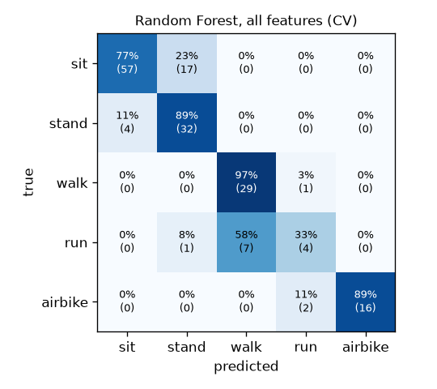
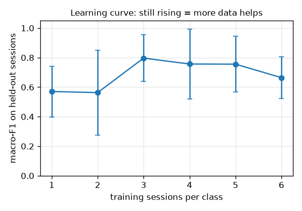
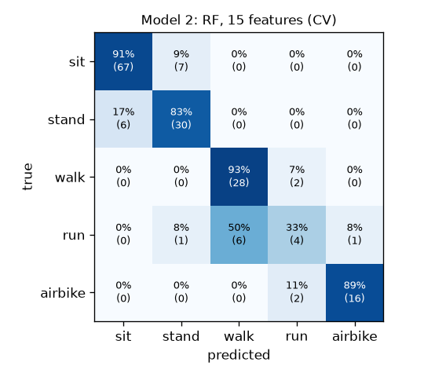
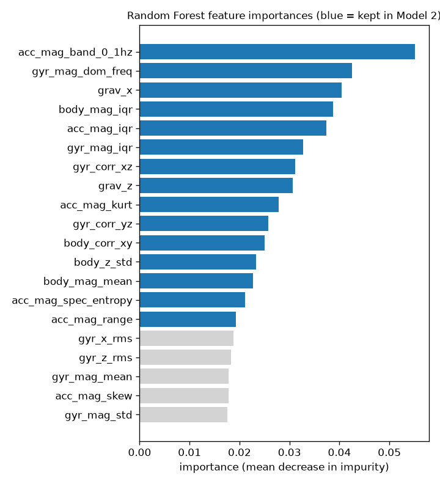
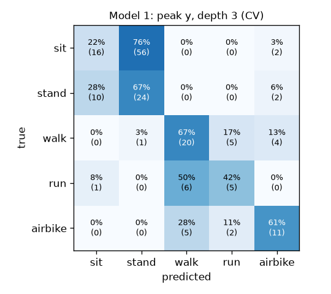
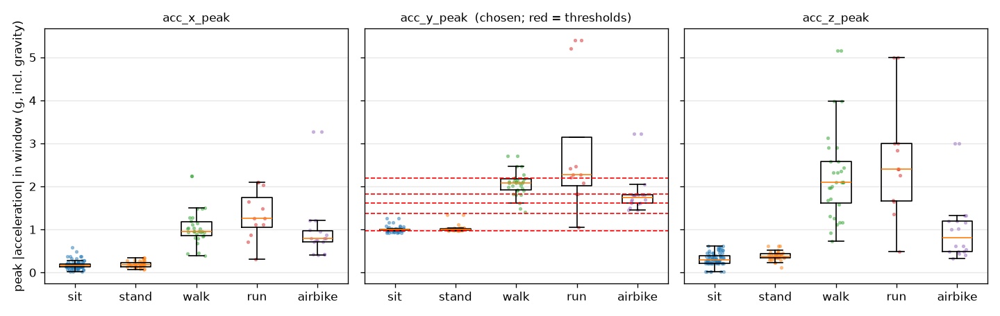

# Training report (2026-10-29T03:48:09)

## Data notes

- ankle_stand_s01_2026-10-27T13-53.csv: warning, sensible values: |mean a| 1.022 g; mean |a| 1.026 g, std 0.029 g; gyro rms 14.3 °/s; gravity dir (x,y,z) = (+0.09, +0.95, -0.29) — a lot of motion for 'stand' (kept)
- ankle_sit_s02_2026-10-27T14-21.csv: warning, sensible values: |mean a| 0.974 g; mean |a| 1.013 g, std 0.038 g; gyro rms 13.7 °/s; gravity dir (x,y,z) = (+0.07, +0.99, -0.09) — a lot of motion for 'sit' (kept)
- ankle_sit_s03_2026-10-27T14-21.csv: warning, sensible values: |mean a| 1.013 g; mean |a| 1.025 g, std 0.018 g; gyro rms 11.3 °/s; gravity dir (x,y,z) = (+0.02, +0.94, -0.34) — a lot of motion for 'sit' (kept)
- ankle_run_s02_2026-10-27T14-28.csv: shorter than one window after trimming 5 s each end -> skipped
- ankle_run_s04_2026-10-28T02-09.csv: FAILED validation (sensible values: |mean a| 1.202 g; mean |a| 1.364 g, std 0.444 g; gyro rms 106.1 °/s; gravity dir (x,y,z) = (+0.07, +0.83, -0.55) — |mean a| outside 0.8–1.2 g) -> skipped
- ankle_stand_s06_2026-10-28T03-06.csv: warning, sensible values: |mean a| 1.003 g; mean |a| 1.013 g, std 0.015 g; gyro rms 18.3 °/s; gravity dir (x,y,z) = (+0.04, +0.99, -0.15) — a lot of motion for 'stand' (kept)

## Dataset

```
         sessions  windows
label                     
airbike         3       18
run             2       12
sit             7       74
stand           6       36
walk            5       30
```

## Stage 5: model comparison (session-grouped CV)

```
               model  accuracy  accuracy_std  macro_f1  seconds
0           logistic     0.836         0.164     0.833    1.660
1            svm_rbf     0.833         0.179     0.805    0.307
2      random_forest     0.808         0.165     0.755   11.653
3                knn     0.801         0.173     0.751    0.330
4  gradient_boosting     0.805         0.144     0.728   38.191
```

### Random Forest per class

```
         precision  recall  f1-score  windows
sit          0.934   0.770     0.844   74.000
stand        0.640   0.889     0.744   36.000
walk         0.806   0.967     0.879   30.000
run          0.571   0.333     0.421   12.000
airbike      1.000   0.889     0.941   18.000
```



### Most confused

- true **run** predicted as **walk**: 58% of run windows
- true **sit** predicted as **stand**: 23% of sit windows
- true **airbike** predicted as **run**: 11% of airbike windows
- true **stand** predicted as **sit**: 11% of stand windows
- true **run** predicted as **stand**: 8% of run windows

### Per recording (worst first)

Each recording scored while it was held out. A recording mostly predicted as another class is a hard case or a bad/mislabelled file: look at its plot first.

```
                               session    label  windows  accuracy               predicted
0       ankle_run_s03_2026-10-27T14-28      run        6      0.00                  walk 6
1       ankle_sit_s02_2026-10-27T14-21      sit        6      0.00                 stand 6
2       ankle_sit_s04_2026-10-27T14-22      sit        6      0.50          sit 3, stand 3
3     ankle_stand_s05_2026-10-28T02-08    stand        6      0.50          stand 3, sit 3
4   ankle_airbike_s01_2026-10-27T14-23  airbike        6      0.67        airbike 4, run 2
5       ankle_run_s01_2026-10-27T14-25      run        6      0.67  run 4, walk 1, stand 1
6       ankle_sit_s01_2026-10-27T13-38      sit       38      0.79         sit 30, stand 8
7     ankle_stand_s01_2026-10-27T13-53    stand        6      0.83          stand 5, sit 1
8      ankle_walk_s05_2026-10-28T02-15     walk        6      0.83           walk 5, run 1
9   ankle_airbike_s02_2026-10-27T14-23  airbike        6      1.00               airbike 6
10  ankle_airbike_s03_2026-10-28T02-11  airbike        6      1.00               airbike 6
11      ankle_sit_s03_2026-10-27T14-21      sit        6      1.00                   sit 6
12      ankle_sit_s05_2026-10-28T02-06      sit        6      1.00                   sit 6
13      ankle_sit_s06_2026-10-28T02-07      sit        6      1.00                   sit 6
14      ankle_sit_s07_2026-10-28T02-14      sit        6      1.00                   sit 6
15    ankle_stand_s02_2026-10-27T13-58    stand        6      1.00                 stand 6
16    ankle_stand_s03_2026-10-27T14-03    stand        6      1.00                 stand 6
17    ankle_stand_s04_2026-10-27T14-03    stand        6      1.00                 stand 6
18    ankle_stand_s06_2026-10-28T03-06    stand        6      1.00                 stand 6
19     ankle_walk_s01_2026-10-27T14-18     walk        6      1.00                  walk 6
20     ankle_walk_s02_2026-10-27T14-19     walk        6      1.00                  walk 6
21     ankle_walk_s03_2026-10-27T14-20     walk        6      1.00                  walk 6
22     ankle_walk_s04_2026-10-28T02-07     walk        6      1.00                  walk 6
```


### Augmentation

Random Forest macro-F1 without augmentation 0.755, with 2 augmented copies per training recording 0.777 -> augmentation HELPS, used for the final model.

### Learning curve

```
   sessions_per_class  mean   std  count
0                   1 0.570 0.172      5
1                   2 0.563 0.287      5
2                   3 0.797 0.158      5
3                   4 0.757 0.236      5
4                   5 0.756 0.188      5
5                   6 0.664 0.141      3
```



### Feature importances (top 20)

```
                      importance
acc_mag_band_0_1hz         0.055
gyr_mag_dom_freq           0.042
grav_x                     0.040
body_mag_iqr               0.039
acc_mag_iqr                0.037
gyr_mag_iqr                0.033
gyr_corr_xz                0.031
grav_z                     0.031
acc_mag_kurt               0.028
gyr_corr_yz                0.026
body_corr_xy               0.025
body_z_std                 0.023
body_mag_mean              0.023
acc_mag_spec_entropy       0.021
acc_mag_range              0.019
gyr_x_rms                  0.019
gyr_z_rms                  0.018
gyr_mag_mean               0.018
acc_mag_skew               0.018
gyr_mag_std                0.018
```

## Stage 6: Model 2 (all IMU outputs)

How many features to keep (grouped CV):

```
          k  n_features  macro_f1  macro_f1_std
0        10          10     0.710         0.142
1        15          15     0.856         0.152
2        20          20     0.790         0.202
3  all (71)          71     0.808         0.183
```

Kept 15 features: `acc_mag_band_0_1hz`, `gyr_mag_dom_freq`, `grav_x`, `body_mag_iqr`, `acc_mag_iqr`, `gyr_mag_iqr`, `gyr_corr_xz`, `grav_z`, `acc_mag_kurt`, `gyr_corr_yz`, `body_corr_xy`, `body_z_std`, `body_mag_mean`, `acc_mag_spec_entropy`, `acc_mag_range`

CV macro-F1 with these features: **0.771** (accuracy 0.839). The feature ranking used all data, so this is a little optimistic; the 'k' table above is the honest estimate.

```
         precision  recall  f1-score  windows
sit          0.918   0.905     0.912   74.000
stand        0.789   0.833     0.811   36.000
walk         0.824   0.933     0.875   30.000
run          0.500   0.333     0.400   12.000
airbike      0.941   0.889     0.914   18.000
```





## Stage 7: Model 1 (peak acceleration, ONE axis)

Every axis x depth, grouped CV:

```
  axis     feature  depth  macro_f1  macro_f1_std  accuracy
0    x  acc_x_peak      2     0.286         0.146     0.400
1    x  acc_x_peak      3     0.363         0.138     0.423
2    y  acc_y_peak      2     0.266         0.138     0.351
3    y  acc_y_peak      3     0.466         0.094     0.469
4    z  acc_z_peak      2     0.212         0.103     0.337
5    z  acc_z_peak      3     0.254         0.057     0.329
```

Best: **y axis** (`acc_y_peak`), depth 3, macro-F1 **0.466** vs Model 2 **0.771**.

Rules:

```
if acc_y_peak <= 1.370 g:
    if acc_y_peak <= 0.973 g:
        -> sit  (100% of balanced training windows here)
    else:  # acc_y_peak > 0.973 g
        -> stand  (48% of balanced training windows here)
else:  # acc_y_peak > 1.370 g
    if acc_y_peak <= 1.816 g:
        -> airbike  (83% of balanced training windows here)
    else:  # acc_y_peak > 1.816 g
        if acc_y_peak <= 2.198 g:
            -> walk  (69% of balanced training windows here)
        else:  # acc_y_peak > 2.198 g
            -> run  (71% of balanced training windows here)

Same thing as ranges:
  acc_y_peak <= 0.97 g               -> sit
  0.97 < acc_y_peak <= 1.37 g        -> stand
  1.37 < acc_y_peak <= 1.82 g        -> airbike
  1.82 < acc_y_peak <= 2.20 g        -> walk
  acc_y_peak >  2.20 g               -> run
```

```
         precision  recall  f1-score  windows
sit          0.593   0.216     0.317   74.000
stand        0.296   0.667     0.410   36.000
walk         0.645   0.667     0.656   30.000
run          0.417   0.417     0.417   12.000
airbike      0.579   0.611     0.595   18.000
```





### What Model 1 can't separate

- **walk vs airbike**: 81% of their windows fall in the shared range: a gentle walk and hard pedalling can reach similar peaks. One peak value measures how hard the shin is jolted, not its rhythm, rotation or posture.
- **walk vs run**: 81% of their windows fall in the shared range: a slow jog and a brisk walk jolt the shin about equally hard. One peak value measures how hard the shin is jolted, not its rhythm, rotation or posture.
- **run vs airbike**: 80% of their windows fall in the shared range: a slow jog's heel strike and a hard pedal stroke can jolt the shin equally. One peak value measures how hard the shin is jolted, not its rhythm, rotation or posture.
- **sit vs stand**: 79% of their windows fall in the shared range: both are still, so the peak is just gravity; it only differs if the shin tilts when you sit. One peak value measures how hard the shin is jolted, not its rhythm, rotation or posture.

## What to record next

- Record more 'walk' (5 so far, aim for 6+).
- Record more 'run' (2 so far, aim for 6+).
- Record more 'airbike' (3 so far, aim for 6+).
- 'sit' recall is only 77%, mostly predicted as 'stand' (23%): record more varied 'sit' sessions (different speeds, days, strap positions), and more 'stand' too.
- 'run' recall is only 33%, mostly predicted as 'walk' (58%): record more varied 'run' sessions (different speeds, days, strap positions), and more 'walk' too.
- The learning curve has flattened: more of the SAME kind of data won't help much; add variety (other people, speeds, surfaces) instead.
